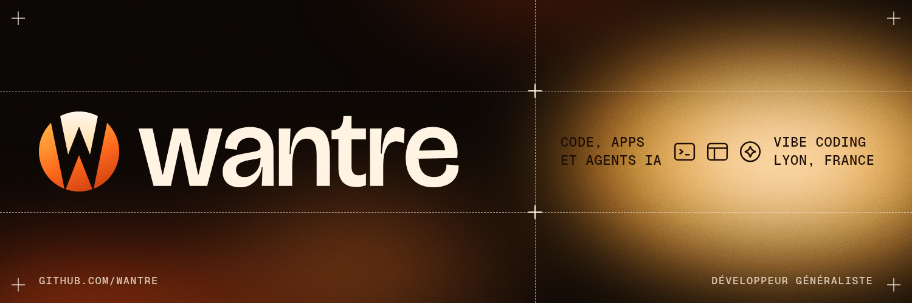

  

### Bonjour, ici Wantre.

Développeur généraliste basé dans la région lyonnaise. Je fais du freelance en informatique depuis mes 16 ans, et je pratique aussi le vibe coding : je conçois des logiciels avec des agents IA, en gardant la main sur l’architecture, le design et les tests.

J’aime les outils qui se voient : des interfaces soignées, des animations justes, et une expérience qui donne envie de s’en servir.

#### Ce que je construis

- **Des applications de bureau** légères, en Rust avec Tauri ou en Go.
- **Des sites et des pages de présentation** animés, rapides, accessibles au clavier.
- **Des outils pour agents IA** : connecteurs MCP, ponts vers Claude Code, Codex, Cursor ou Gemini CLI, sans clé API quand c’est possible.

#### Projets

| Projet | En bref | |
|---|---|---|
| [**Better GrokBot**](https://github.com/Wantre/better-grokbot) | Une copie privée de Grok Bot avec un vrai châssis : rail, palette Ctrl K, barre Répond vers d’autres IA, quotas en direct. L’original n’est jamais modifié. | [Voir le site](https://wantre.github.io/better-grokbot/) |
| **Verrière** | Un studio de bureau pour créer des sites avec des agents IA : éditeur visuel, timeline d’animation, CMS et publication. Rust et Tauri 2. | Privé, en cours |

#### Outils

**Langages** · Rust, Go, TypeScript, JavaScript, HTML, CSS 
**Applications** · Tauri 2, Node.js, React Native avec Expo 
**Agents IA** · MCP, Claude Code, Codex, Cursor, Gemini CLI 
**Design** · animation au défilement, design system, accessibilité

#### Parcours

Bac pro ARED (audiovisuel, domotique, électricité), puis deux ans de parcours à l’École 42 Lyon. Freelance en informatique en parallèle, depuis mes 16 ans.

#### Me contacter

Le plus simple : ouvrir une [issue](https://github.com/Wantre/Wantre/issues) sur ce dépôt, ou passer par un des projets ci-dessus.
