

  <picture><source media="(prefers-color-scheme: dark)" srcset="assets/hero-dark.svg"><source media="(prefers-color-scheme: light)" srcset="assets/hero-light.svg"></picture>

  Je conçois des apps de bureau, des sites animés et des outils pour agents IA. 
  Freelance en informatique depuis mes 16 ans, je pratique aussi le vibe coding : les agents écrivent avec moi, je garde la main sur l’architecture, le design et les tests.

  <picture><source media="(prefers-color-scheme: dark)" srcset="assets/terminal-dark.svg"><source media="(prefers-color-scheme: light)" srcset="assets/terminal-light.svg"></picture>

<picture><source media="(prefers-color-scheme: dark)" srcset="assets/divider-dark.svg"><source media="(prefers-color-scheme: light)" srcset="assets/divider-light.svg">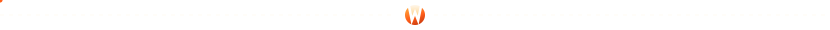</picture>

  <a href="https://wantre.github.io/verriere/"><picture><source media="(prefers-color-scheme: dark)" srcset="assets/projet-verriere-dark.svg"><source media="(prefers-color-scheme: light)" srcset="assets/projet-verriere-light.svg"></picture></a>
  <a href="https://wantre.github.io/better-grokbot/"><picture><source media="(prefers-color-scheme: dark)" srcset="assets/projet-better-grokbot-dark.svg"><source media="(prefers-color-scheme: light)" srcset="assets/projet-better-grokbot-light.svg">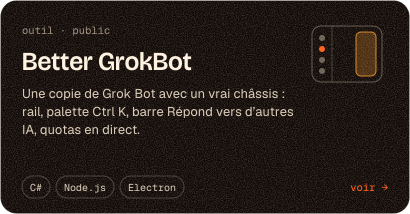</picture></a>

  <picture><source media="(prefers-color-scheme: dark)" srcset="assets/projet-jarvis-dark.svg"><source media="(prefers-color-scheme: light)" srcset="assets/projet-jarvis-light.svg">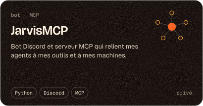</picture>
  <picture><source media="(prefers-color-scheme: dark)" srcset="assets/projet-quant-dark.svg"><source media="(prefers-color-scheme: light)" srcset="assets/projet-quant-light.svg">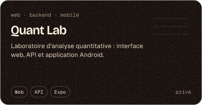</picture>

  <picture><source media="(prefers-color-scheme: dark)" srcset="assets/projet-calame-dark.svg"><source media="(prefers-color-scheme: light)" srcset="assets/projet-calame-light.svg">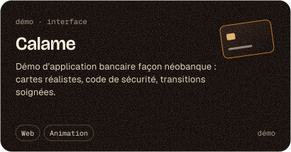</picture>
  <a href="https://wantre.github.io/cinevr/"><picture><source media="(prefers-color-scheme: dark)" srcset="assets/projet-cinevr-dark.svg"><source media="(prefers-color-scheme: light)" srcset="assets/projet-cinevr-light.svg">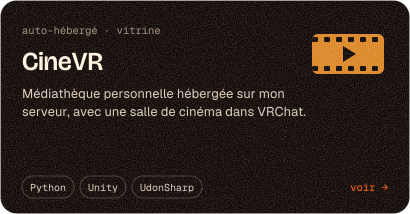</picture></a>

  <picture><source media="(prefers-color-scheme: dark)" srcset="assets/projet-psycho-dark.svg"><source media="(prefers-color-scheme: light)" srcset="assets/projet-psycho-light.svg">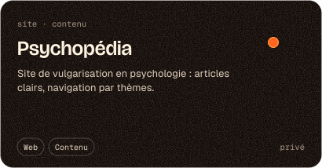</picture>
  <picture><source media="(prefers-color-scheme: dark)" srcset="assets/projet-jeux-dark.svg"><source media="(prefers-color-scheme: light)" srcset="assets/projet-jeux-light.svg">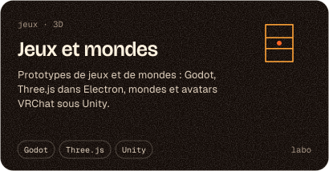</picture>

  <picture><source media="(prefers-color-scheme: dark)" srcset="assets/stack-dark.svg"><source media="(prefers-color-scheme: light)" srcset="assets/stack-light.svg">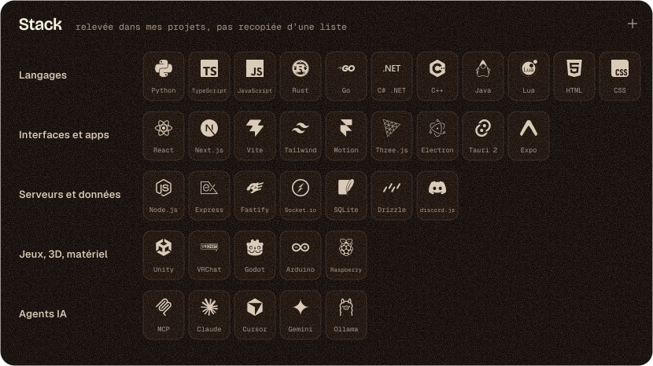</picture>

  <picture><source media="(prefers-color-scheme: dark)" srcset="assets/orbit-dark.svg"><source media="(prefers-color-scheme: light)" srcset="assets/orbit-light.svg"></picture>

<picture><source media="(prefers-color-scheme: dark)" srcset="assets/divider-dark.svg"><source media="(prefers-color-scheme: light)" srcset="assets/divider-light.svg"></picture>

  <picture><source media="(prefers-color-scheme: dark)" srcset="assets/now-dark.svg"><source media="(prefers-color-scheme: light)" srcset="assets/now-light.svg">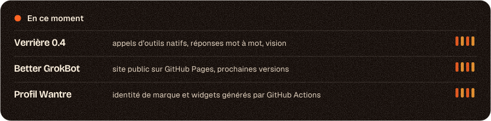</picture>

  <picture><source media="(prefers-color-scheme: dark)" srcset="assets/timeline-dark.svg"><source media="(prefers-color-scheme: light)" srcset="assets/timeline-light.svg">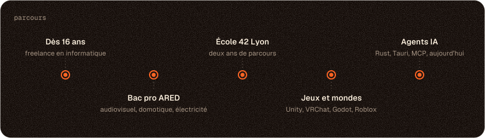</picture>

<picture><source media="(prefers-color-scheme: dark)" srcset="assets/divider-dark.svg"><source media="(prefers-color-scheme: light)" srcset="assets/divider-light.svg"></picture>

  <picture><source media="(prefers-color-scheme: dark)" srcset="https://raw.githubusercontent.com/Wantre/Wantre/output/stats-dark.svg"><source media="(prefers-color-scheme: light)" srcset="https://raw.githubusercontent.com/Wantre/Wantre/output/stats-light.svg"></picture>

  <picture><source media="(prefers-color-scheme: dark)" srcset="https://raw.githubusercontent.com/Wantre/Wantre/output/calendar-dark.svg"><source media="(prefers-color-scheme: light)" srcset="https://raw.githubusercontent.com/Wantre/Wantre/output/calendar-light.svg">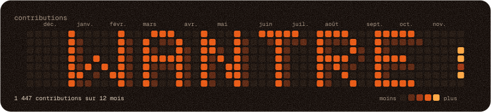</picture>

<b>Comment c’est fait</b>

 

Aucune image n’est une capture ni un service externe : chaque visuel est un SVG écrit par un script de ce dépôt.

- `scripts/build_assets.py` dessine les cartes, le terminal, l’orbite et la frise. Le texte est vectorisé à partir de polices libres (Bricolage Grotesque, Geist, Geist Mono), puis réutilisé glyphe par glyphe. Les animations sont en SMIL, sans JavaScript, et chaque visuel existe en version sombre et claire.
- `scripts/stats.py` interroge l’API GraphQL de GitHub et écrit les statistiques et le calendrier. L’action `.github/workflows/widgets.yml` le lance chaque jour et publie le résultat sur la branche `output`.
- Les logos viennent de [Simple Icons](https://simpleicons.org) (CC0). Les marques appartiennent à leurs propriétaires.
- Le mot WANTRE dans le graphe de contributions est un dessin : voir [contributions-art](https://github.com/Wantre/contributions-art).

  Pour me joindre : une <a href="https://github.com/Wantre/Wantre/issues">issue</a> sur ce dépôt. · Sites : <a href="https://wantre.github.io/verriere/">Verrière</a> · <a href="https://wantre.github.io/better-grokbot/">Better GrokBot</a>

